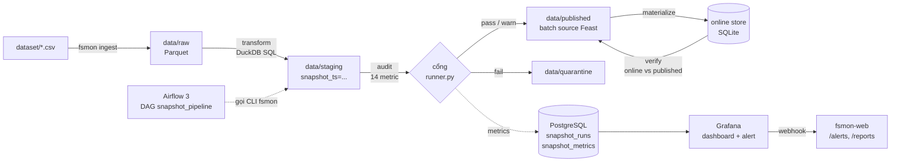
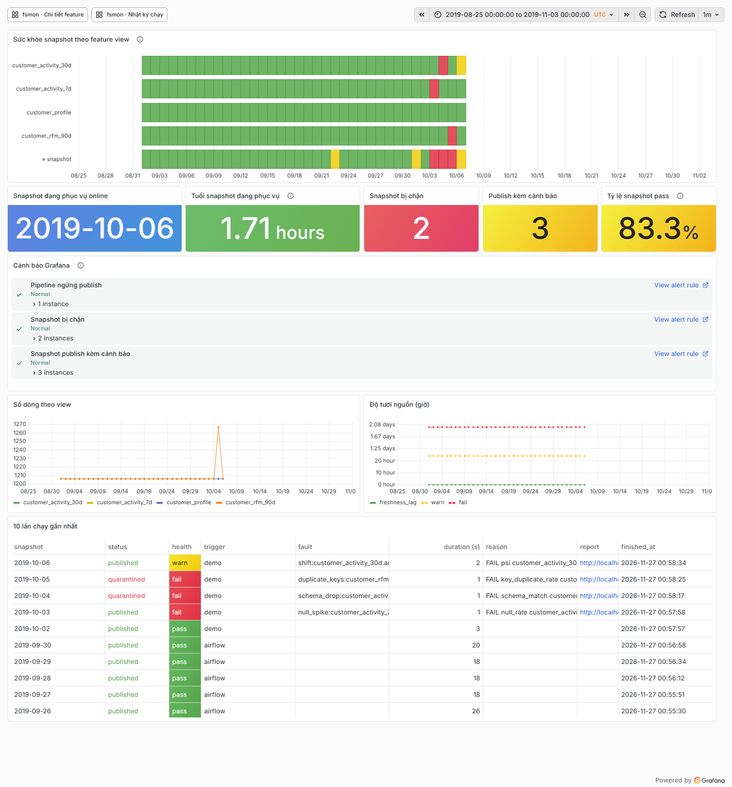
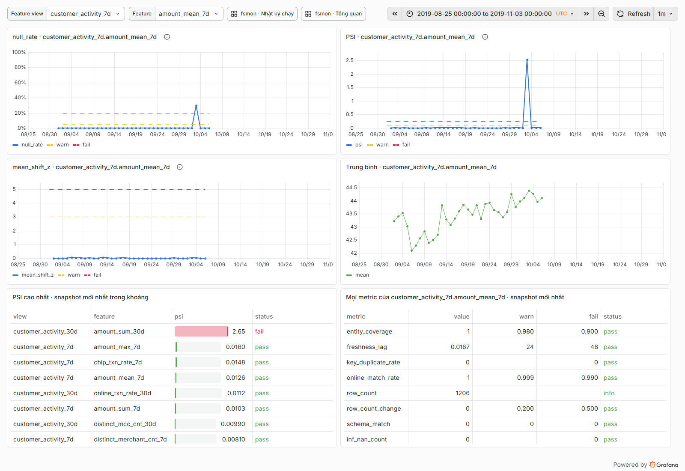
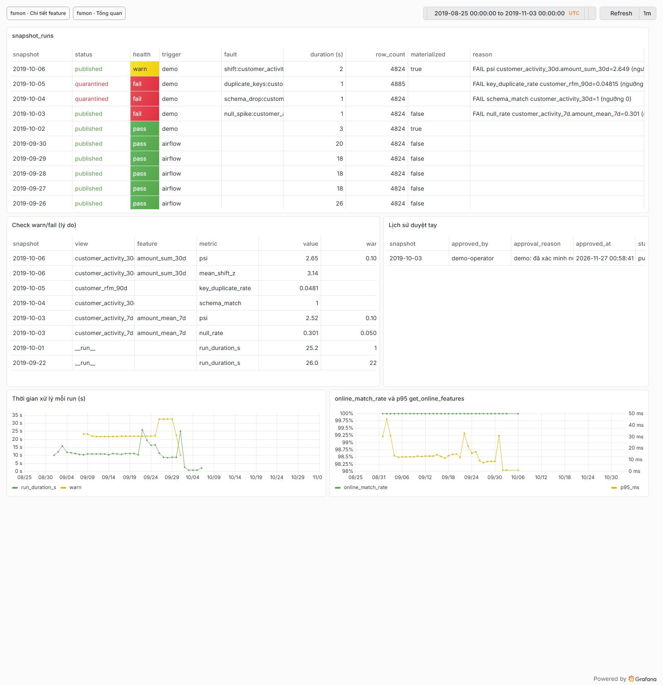
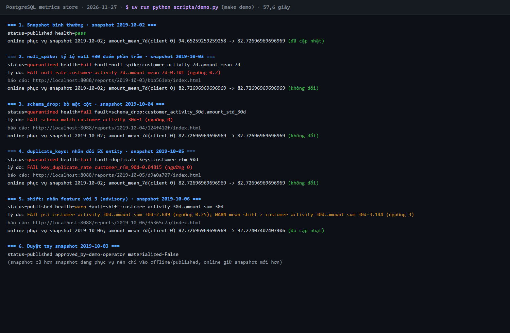
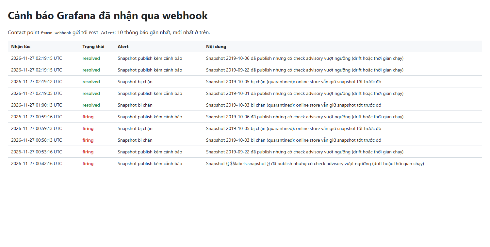
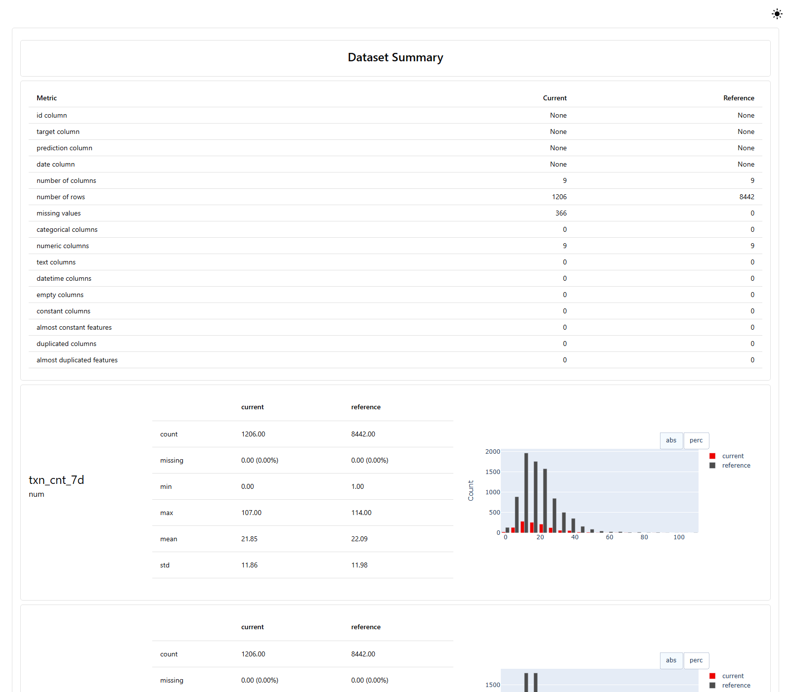
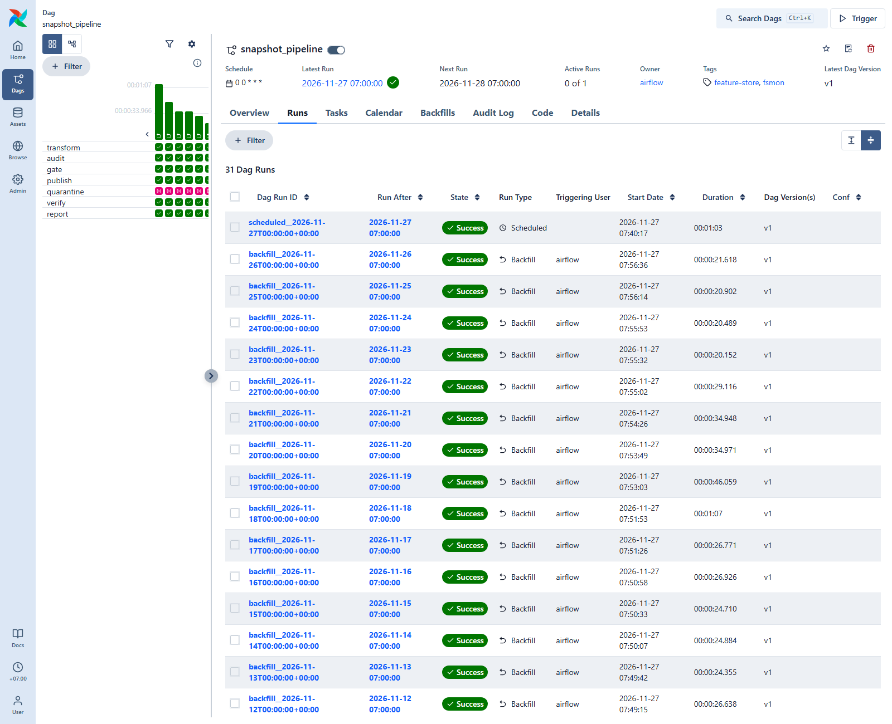

# feature-store

Feature store chạy hoàn toàn local bằng **Feast**, tự cập nhật theo lịch, và chấm điểm sức khỏe từng
snapshot trước khi cho nó vào online store. Cổng chất lượng (`fsmon`) là phần tự dựng, đặt cạnh Feast.



Feast chỉ đọc từ `data/published/`, nên snapshot chưa qua cổng không thể vào training hay serving.



<details><summary>Chi tiết feature và Nhật ký chạy</summary>




</details>

## Trạng thái so với tiêu chí hoàn thành

| Tiêu chí | Trạng thái |
| --- | --- |
| `make snapshot` chạy trọn raw → staging → audit → publish → materialize | Đạt (local và trong Airflow) |
| Chạy lại cùng `snapshot_ts` không sinh bản trùng (có pytest) | Đạt (`test_publish_twice_same_snapshot_no_duplicates`) |
| Backfill ≥ 30 snapshot, dashboard có xu hướng | Đạt: 30 snapshot qua CLI và 30 qua `airflow backfill create` |
| Schedule tự chạy ≥ 3 chu kỳ liên tiếp | **1/3**: lần chạy theo lịch 2026-11-27 thành công; 2 chu kỳ còn lại chạy lúc 00:00 UTC các ngày 2026-11-28 và 2026-11-29 nếu Docker vẫn bật |
| Mỗi blocker có test chặn đúng snapshot lỗi | Đạt |
| Sau fail, online store giữ snapshot tốt gần nhất | Đạt (test + demo) |
| `make up` dựng PostgreSQL và Grafana; dashboard, alert rule tự nạp; alert thử gửi được | Đạt: thông báo nhận tại `http://localhost:8088/alerts` |
| CI xanh: lint, test, `feast plan` | Lint, test, `feast plan` xanh trên máy; workflow chưa chạy trên GitHub vì code chưa được commit và push |
| README có sơ đồ, hướng dẫn, ảnh dashboard | Đạt |

## Dataset

IBM financial transactions (thư mục `dataset/`, không commit):

| File | Nội dung | Dùng làm |
| --- | --- | --- |
| `transactions_data.csv` | 13,3 triệu giao dịch, 2010-01-01 → 2019-10-31 | Nguồn chính của feature hoạt động |
| `users_data.csv` | 2000 khách hàng | Feature hồ sơ |
| `cards_data.csv` | 6146 thẻ (bỏ số thẻ và CVV khi ingest) | Feature hồ sơ |
| `mcc_codes.json` | 109 mã ngành hàng | Tra cứu |
| `train_fraud_labels.json` | Nhãn gian lận theo giao dịch | Chỉ nạp khi `fsmon ingest --labels` (cho mô hình hạ nguồn, chưa dùng) |

**Đồng hồ phát lại.** Dữ liệu dừng ở 2019, còn lịch chạy dùng giờ thật. `config/pipeline.yaml` ánh xạ
`snapshot_ts = 2019-10-01 + (logical_date − 2026-11-27)`: lịch ngày 2026-11-27 tính snapshot 2019-10-01,
mỗi ngày thật tiến một ngày dữ liệu (đủ cho khoảng 30 ngày chạy định kỳ tới 2019-10-31).

## Thiết kế Feast

Entity `customer` (khóa `client_id`, INT64). Quần thể của mỗi snapshot là các khách có giao dịch trong 90 ngày
trước `snapshot_ts` (khoảng 1206 khách cho giai đoạn 2019).

| Feature view | Feature | TTL |
| --- | --- | --- |
| `customer_profile` | `current_age`, `credit_score`, `yearly_income`, `total_debt`, `debt_to_income`, `num_credit_cards`, `card_cnt`, `total_credit_limit`, `avg_card_age_years`, `gender` | 3 ngày |
| `customer_activity_7d` | `txn_cnt_7d`, `amount_sum_7d`, `amount_mean_7d`, `amount_max_7d`, `refund_cnt_7d`, `online_txn_rate_7d`, `chip_txn_rate_7d`, `error_cnt_7d`, `distinct_merchant_cnt_7d` | 3 ngày |
| `customer_activity_30d` | `txn_cnt_30d`, `amount_sum_30d`, `amount_mean_30d`, `amount_std_30d`, `refund_cnt_30d`, `error_rate_30d`, `online_txn_rate_30d`, `distinct_mcc_cnt_30d`, `top_mcc_30d` | 3 ngày |
| `customer_rfm_90d` | `days_since_last_txn`, `txn_cnt_90d`, `amount_sum_90d`, `avg_ticket_90d`, `active_days_90d` | 3 ngày |

Feature service: `customer_risk_v1` (18 feature chọn lọc), `customer_spend_v1` (30d + RFM).
Hợp đồng kiểu, nullable và miền giá trị nằm trong `config/checks.yaml`; `tests/test_pipeline.py` kiểm nó khớp
schema khai báo trong `feature_repo/feature_views.py`.

## Chạy từ máy sạch

Yêu cầu: [uv](https://docs.astral.sh/uv/), Docker (Docker Desktop hoặc Docker Engine trong WSL2), `make`, Git Bash
hoặc shell Linux.

```bash
uv sync                    # môi trường pipeline (Python 3.11, phiên bản ghim trong uv.lock)
make up                    # PostgreSQL + Grafana + fsmon-web, tạo bảng metrics
make ingest                # dataset/*.csv -> data/raw/*.parquet (~10 giây)
make backfill              # 30 snapshot 2019-09-01..2019-09-30 (~2-3 giây mỗi snapshot)
make demo                  # kịch bản demo 5 phút (mục dưới)
make airflow               # Airflow 3 trong Docker, DAG snapshot_pipeline chạy @daily
```

| Địa chỉ | Là gì |
| --- | --- |
| http://localhost:3000 | Grafana (admin/admin; xem ẩn danh được): Tổng quan, Chi tiết feature, Nhật ký chạy |
| http://localhost:8080 | Airflow |
| http://localhost:8088/reports/ | Báo cáo Evidently HTML của snapshot warn/fail |
| http://localhost:8088/alerts.html | Thông báo Grafana đã gửi tới contact point webhook (JSON ở `/alerts`) |
| `data/alerts.log` | Dấu vết cảnh báo do `runner.py` ghi, vẫn có khi Grafana tắt |

Chạy pipeline không cần Docker (kho metrics SQLite):

```bash
export FSMON_DB_DSN=sqlite:///$PWD/data/metrics.db
uv run fsmon init-db && uv run fsmon run --snapshot-ts 2019-09-01
```

### Lệnh `fsmon`

| Lệnh | Việc |
| --- | --- |
| `transform` | raw → staging cho một mốc; tạo run mới |
| `audit` | chạy mọi check, ghi metrics vào PostgreSQL, ra quyết định cổng |
| `decision` | in `pass` / `warn` / `fail` (task rẽ nhánh của DAG đọc lệnh này) |
| `publish` | xóa hàng cùng `snapshot_ts` trong `published/`, chèn snapshot mới, `feast apply` nếu định nghĩa đổi, materialize |
| `verify` | lấy mẫu 300 entity, so online với published; lệch quá ngưỡng thì `failed_after_gate` và khôi phục |
| `quarantine` | chuyển staging sang `quarantine/`, cảnh báo |
| `report` | chốt run, tính `run_duration_s`, sinh báo cáo Evidently nếu warn/fail |
| `run` / `backfill` | trọn chuỗi cho một mốc / một dải mốc |
| `approve` | publish một snapshot đang quarantine, lưu người duyệt và lý do |
| `restore` | dựng lại online store từ snapshot đã publish gần nhất |
| `status` | các run gần nhất và snapshot đang phục vụ |

Mốc truyền bằng `--snapshot-ts YYYY-MM-DD` (thời gian dữ liệu) hoặc `--logical-date YYYY-MM-DD` (qua đồng hồ phát lại).

## Cổng chất lượng

14 loại metric, ngưỡng trong `config/checks.yaml`. Giá trị và ngưỡng lưu cùng thang đo, nên Grafana vẽ được đường
ngưỡng ngay trên chuỗi giá trị.

| Loại | Check | Khi fail |
| --- | --- | --- |
| Blocker | `schema_match`, `key_duplicate_rate`, `row_count_change`, `entity_coverage`, `freshness_lag`, `inf_nan_count`, `out_of_range_rate`, `null_rate` | Quarantine, không publish |
| Advisory | `psi`, `mean_shift_z`, `distinct_count`, `run_duration_s` | Publish, trạng thái warn |
| Sau publish | `online_match_rate` | `failed_after_gate`, gỡ khỏi published, khôi phục online từ snapshot tốt trước |

- Baseline là trung vị của tối đa 7 snapshot đã publish gần nhất; snapshot quarantine không vào baseline.
- Khởi động nguội: khi chưa đủ 7 snapshot, check tương đối vẫn ghi metric nhưng có trạng thái `info` và nhãn
  `baseline_incomplete`. Check tuyệt đối (schema, khóa, miền giá trị, inf/NaN, độ tươi, null của feature
  `nullable: false`) áp dụng ngay từ snapshot đầu.

**Hiệu chỉnh trên 28 snapshot bình thường (2019-09-08 → 2019-10-05):** 0% snapshot bị warn.

| Metric | Lớn nhất quan sát được | Ngưỡng warn |
| --- | --- | --- |
| `psi` | 0,022 (`days_since_last_txn`) | 0,10 |
| `mean_shift_z` | 0,069 | 3 |
| `null_rate` (nullable) | 0,0017 | baseline + 0,05 |
| `row_count_change` | 0 | 0,20 |
| `entity_coverage` | 1,0 (nhỏ nhất) | 0,98 |

Hai điều chỉnh so với kế hoạch, rút ra từ lần hiệu chỉnh này:

- `run_duration_s` đo **thời gian xử lý** (tổng các bước, không tính thời gian chờ của scheduler), có sàn
  `min_warn_s: 10`, và chỉ so với run cùng môi trường (Airflow với Airflow, CLI với CLI). Trong container,
  I/O qua thư mục mount từ ổ C chậm hơn chạy native: khoảng 11 giây so với 2–3 giây. Lý do: trung vị chỉ khoảng 2 giây, nên quy tắc "> 2× trung vị" sẽ báo giả ở mọi lần chạy chậm
  hơn một chút, và mọi lần chạy qua Airflow.
- `mean_shift_z` theo công thức của kế hoạch (chia cho độ lệch chuẩn giữa các entity) rất ít nhạy: lỗi `shift`
  nhân feature với 3 chỉ cho z khoảng 3,1 trong khi PSI đạt 2,68. Check này được giữ để ghi nhận, còn PSI mới là
  check drift chính.

## Kịch bản demo

`make demo` (hoặc `uv run python scripts/demo.py --pause` để dừng giữa các bước). Kết quả thật trên dataset:

| Bước | Lỗi | Kết quả | Online store |
| --- | --- | --- | --- |
| 1 | — | published · pass | cập nhật |
| 2 | `null_spike` (+30 điểm %) | quarantined · `null_rate` 0,301 > 0,2008 | không đổi |
| 3 | `schema_drop` | quarantined · `schema_match` thiếu `amount_std_30d` | không đổi |
| 4 | `duplicate_keys` (5%) | quarantined · `key_duplicate_rate` 0,048 > 0 | không đổi |
| 5 | `shift` (×3) | **published · warn** · `psi` 2,68 (advisory) | cập nhật |
| 6 | `approve` snapshot bước 2 | published, lưu người duyệt và lý do | không đổi (snapshot cũ hơn bản đang phục vụ) |

Từng lỗi riêng lẻ: `make demo-fault FAULT=null_spike|schema_drop|duplicate_keys|shift|out_of_range|row_drop|stale`.

### Ảnh chụp demo (2026-11-27, kho metrics PostgreSQL)

**Kết quả `make demo` trong terminal**: 3 lỗi blocker bị chặn và online store không đổi; `shift` vẫn publish kèm warn;
duyệt tay chỉ ghi vào offline.



**Cảnh báo Grafana đã nhận qua webhook** (`http://localhost:8088/alerts.html`): mỗi snapshot bị chặn hoặc publish kèm
cảnh báo có một thông báo firing, sau đó resolved. Dòng cuối là lần gửi đầu tiên, trước khi sửa template `$labels`.



**Báo cáo Evidently của snapshot null_spike** (2019-10-03, `customer_activity_7d`): 366 giá trị thiếu ở snapshot hiện
tại so với 0 ở baseline gộp 7 snapshot.



**Airflow**: 31 lần chạy `snapshot_pipeline` đều thành công, gồm 1 lần theo lịch và 30 lần backfill; cột `quarantine`
bị bỏ qua (màu hồng) vì cổng cho đi nhánh `publish`.



## Airflow

Đã chạy thật: 1 lần theo lịch + 30 lần backfill (`make airflow-backfill`), tất cả thành công, 1/30 snapshot warn
(`run_duration_s` khi máy đang bận chạy pytest song song: đúng là điều check advisory cần bắt).

DAG `dags/snapshot_pipeline.py` chỉ gọi CLI: `transform → audit → gate ─┬ publish → verify ┬ report`, với nhánh
còn lại của gate là `quarantine` dẫn vào `report`.
`max_active_runs=1`, `catchup=False`. Airflow 3.3.2 chạy trong Docker. Pipeline có virtualenv riêng
`/opt/fsmon-venv` trong image (xem `airflow/README.md`). Backfill: `make airflow-backfill`.

## Test và CI

```bash
make test        # 33 test, gồm 2 test tích hợp Feast thật (~2 phút)
make test-fast   # bỏ test tích hợp
make lint
make plan        # feast plan
```

Test gồm: mỗi blocker chặn đúng snapshot lỗi, advisory chỉ cảnh báo, khởi động nguội, transform không dùng dữ
liệu tương lai và tất định, publish chạy lại không sinh bản trùng, online store giữ snapshot tốt sau fail,
`failed_after_gate` khôi phục online, duyệt tay, hợp đồng khớp schema Feast. CI (`.github/workflows/ci.yml`):
lint, test, `feast plan`, và kiểm dashboard JSON khớp `grafana/build_dashboards.py`.

## Cấu trúc

```text
config/            pipeline.yaml (đường dẫn, lịch, đồng hồ phát lại, DSN) · checks.yaml (hợp đồng + ngưỡng)
src/fsmon/         cli · ingest · transform · checks/ · runner · publish · verify_online · report · alert · faults · store
feature_repo/      feature_store.yaml · entities · data_sources · feature_views · feature_services
dags/              snapshot_pipeline.py
airflow/           Dockerfile (Airflow 3.3.2 + /opt/fsmon-venv)
grafana/           build_dashboards.py · provisioning/ (datasource, 3 dashboard, alert rule, contact point)
sql/               schema.sql (bảng + view latest_snapshot_runs, view_health) · init-roles.sh
web/server.py      phục vụ /reports và nhận webhook /alert
scripts/           inject_fault.py · demo.py
tests/             pytest trên dữ liệu tổng hợp
```

## Khác với kế hoạch

| Kế hoạch | Thực tế | Lý do |
| --- | --- | --- |
| WSL2 Ubuntu làm môi trường chính | Pipeline chạy native trên Windows bằng uv; Airflow, PostgreSQL, Grafana trong Docker | Máy chưa có distro Ubuntu; Feast 0.68 chạy được trên Windows; Airflow không chạy native trên Windows nên đặt vào container |
| `feast materialize-incremental` | `materialize` với cửa sổ ±1 phút quanh `snapshot_ts` | Dữ liệu phát lại nằm ở 2019, còn mốc bắt đầu mặc định "now − ttl" của incremental thuộc năm 2026, nên incremental không materialize được gì; materialize tường minh cũng đảm bảo duyệt tay snapshot cũ không ghi đè online |
| Offline store `duckdb` nếu được | `file` | Offline store duckdb của Feast 0.68 cần thêm `ibis` |
| Khôi phục online bằng cách dựng lại file | Xóa dữ liệu trong các bảng online rồi materialize snapshot tốt | Trên Windows, file SQLite đang mở không xóa được |
| `run_duration_s` > 2× trung vị | Thời gian xử lý, sàn 10 giây | Xem mục hiệu chỉnh |
